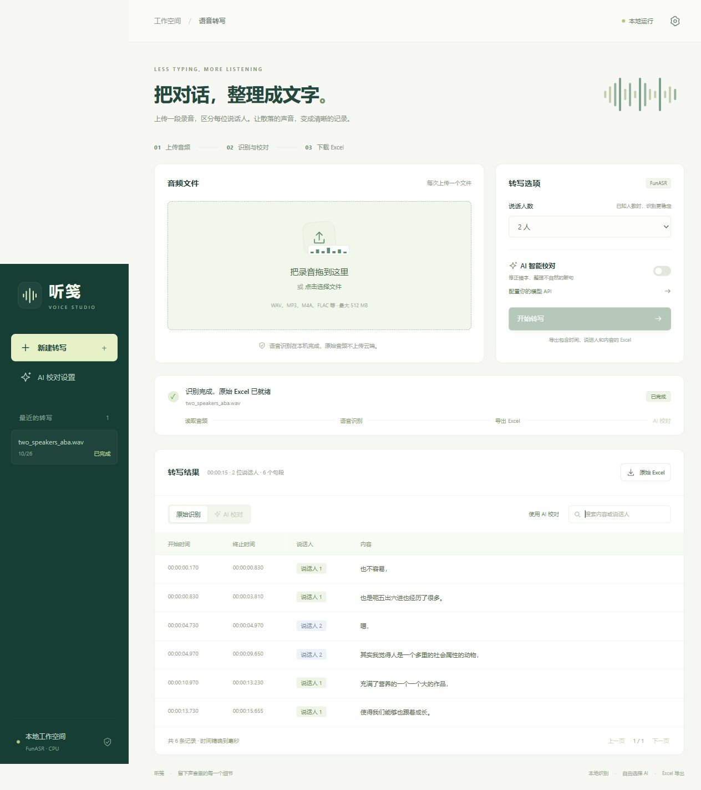

# 听笺 · 本地语音工作台

一个 Windows 本地前后端项目：上传音频，使用 FunASR 区分说话人并转写，导出 Excel；可以连接自己的 OpenAI 兼容 API，另外生成一份 AI 校对 Excel。

## 一键启动

**双击项目根目录的 `start.bat`。** 网页会自动在默认浏览器打开，通常是 <http://127.0.0.1:8765>。

启动程序会检查本目录的 Python 3.12 虚拟环境、FunASR、网页与 Excel 依赖、FFmpeg 和当前选择的模型：

- 全部就绪：直接启动后端和网页。
- 缺少依赖或环境：先列出问题，只有输入 `Y` 后才创建/修复独立环境并安装依赖。其他输入取消。
- 缺少模型：先打开网页，在“语音模型”中选择并点击“下载并切换”，确认后下载到本项目的 `models` 目录；不会一次下载所有模型。
- 没有 uv：在确认安装后，从 Astral 官方发布下载本项目专用 uv，并核对 SHA-256。新装 Python 保存在本项目 `.tools/python`。
- 原来的 `.venv` 不兼容：先在本目录保留为 `.venv.backup-时间`，再创建环境。

### 硬件检测与加速

启动时会读取 CPU、物理核心数、显卡和 NVIDIA 驱动支持的 CUDA 版本，针对本项目固定的 PyTorch 2.8 选择依赖：

- 支持的 NVIDIA 显卡：按驱动版本与计算能力选择 `cu128` 或 `cu126`，同时安装匹配的 torch 和 torchaudio。原来只有 CPU 依赖时，会单独询问是否切换；拒绝加速安装仍可使用已有环境。
- AMD/Intel 核显、驱动不兼容或无法确认架构：继续使用 CPU。此 Windows/PyTorch 2.8 项目不自动安装 DirectML 或 ROCm。
- CUDA 依赖下载失败：在已确认安装的范围内尝试 CPU 依赖。运行时会先执行一个小型 CUDA 运算，验证失败则使用 CPU。
- CPU 线程数根据物理核心数选择，最多 8 线程。模型在同一进程中复用。

本机检测为 Ryzen 5 5600H、6 核 12 线程和 AMD Radeon 核显，因此实际使用 **CPU、6 线程**，不会因安装 CUDA 包而获得显卡加速。NVIDIA CUDA 路径已用模拟硬件信息测试，尚未在实体 NVIDIA 显卡上验证。

`requirements.lock.txt` 中 torch/torchaudio 固定公开版本 `2.8.0`，不再固定为 `+cpu`，具体构建由安装器按硬件选择。`-CheckOnly` 输出中的 `ready` 表示基础环境可用；`acceleration_ok` 单独表示依赖是否匹配推荐加速方案。

首次安装需要联网、数 GB 磁盘空间，模型下载量由网页所选模型决定，已下载的 VAD / CAM++ 等公共组件会复用。不会安装全局 Python 包，也不需要 Node.js。依赖齐全后的本地识别不需要云端识别服务。

保持启动窗口打开；关闭它可退出应用。默认仅监听 `127.0.0.1`。默认端口被其他程序占用时，会尝试后续九个端口，实际地址显示在启动窗口。重复启动会复用同一目录已运行的服务。

### 可选启动参数

在项目目录的 PowerShell 中：

```powershell
# 只检查，不下载、不启动
powershell -NoProfile -ExecutionPolicy Bypass -File .\launcher.ps1 -CheckOnly

# 完全禁止自动安装；环境缺失时退出
.\start.bat -NoInstall

# 启动服务但不自动打开浏览器
.\start.bat -NoBrowser

# 指定起始端口
.\start.bat -Port 8899

# 强制使用 CPU，不切换到 CUDA 依赖
.\start.bat -Device cpu

# 仅配置环境与模型，不启动网页
powershell -NoProfile -ExecutionPolicy Bypass -File .\setup.ps1
```

## 网页使用

1. 拖拽音频到上传区域，或点击选择文件。支持 WAV、MP3、M4A、FLAC、OGG 等，也能从常见视频文件中读取音轨，单文件最大 512 MB。
2. 选择说话人数。已知人数时建议填写，短录音的自动人数估计可能过度分组。
3. 点击“开始转写”，查看读取音频、加载模型、识别和导出的状态。首次下载或加载所选模型需要一些时间；同一进程会复用模型，CPU 上的 Nano 通常明显慢于 Paraformer。
4. 完成后预览、搜索结果，点击“原始 Excel”下载。如果启用了 AI 校对，还能下载“AI 校对 Excel”或包含两份表格的 ZIP。

任务串行处理，避免多个请求同时调用同一套 FunASR 模型。支持查看最近任务，刷新页面后可以继续查看当前任务。应用重启后，已生成的结果仍可下载；未完成的识别需要重新上传。

## 网页选择和下载语音模型

在“转写选项 → 选择 / 下载”或侧边栏“语音模型”打开模型管理。页面列出参数量、下载大小、系统内存与显存建议、语言、适用场景、数字规范化、时间戳及说话人能力，并提供官方资料链接。估算不是官方最低配置或准确率保证。

| 模型 | 主体参数量 | 适用情况 | 时间与说话人 |
| --- | --- | --- | --- |
| Fun-ASR-Nano 2512（默认精度优先） | 800M | 口音、方言、噪声、专业领域；CPU 较慢 | VAD 片段时间 + CAM++，片段内快速换人可能混合 |
| SenseVoice Small | 234M | 普通话、粤语、英语、日语、韩语，兼顾 CPU 速度 | 字符对齐后分句 + CAM++；失败时退回 VAD 片段 |
| SeACo Paraformer-large（原模型） | 约 220M 级 | 普通话、清晰录音、重视速度 | 字符对齐后分句 + CAM++ |

未下载时点击“下载并切换”；已下载时点击“切换并加载”。下载和加载在后台进行，页面显示状态和失败原因。切换前释放旧模型，失败时保留原选择。选择成功后保存到 `data/asr_settings.json`，重启自动恢复；正在识别或校对时不允许切换。每个模型分别保存本地清单，避免把旧模型缓存误认为新模型已经下载。

接入上述三种离线模型，并提供传统模型 + LLM 语音模型的双模型模式，不将 FunASR 全部模型当成可互换选项。它们都依赖额外 CAM++ 区分匿名说话人，不能恢复重叠语音中的独立音轨。Nano 的 Excel 时间表示 VAD 片段边界，不承诺逐字对齐；SenseVoice 接入标点组件以保留较细的句段与说话人边界。

本项目在加载前检查可用系统内存：Nano 至少留出约 6 GB，其他两种约 1.5 GB；这是保守的加载检查，不保证所有长录音均不超内存。CPU 使用 FP32，VAD 单片段最长 30 秒，Nano 单次生成上限 1,024 Token。GPU 加速仍按安装器检测结果选择。

可用 `start.bat -Model sensevoice` 临时指定启动模型，或 `transcribe.py --model paraformer 音频.wav` 使用命令行。普通启动允许先进入网页再下载模型；`-SetupOnly` 仍会在控制台确认后准备当前模型，`-NoInstall` 禁止启动器自动下载。

`SeACo Paraformer-large` 本身就是 large 级别，增加了语义增强的上下文/热词定制模块。当前官方 `paraformer-zh` 别名指向 SeACo；`paraformer` 指向普通 Paraformer-large。本项目原模型属于 SeACo，普通 large 没有保证更高准确率；数字书写仍需单独规范化。详见 [官方别名](https://github.com/modelscope/FunASR/blob/main/funasr/download/name_maps_from_hub.py) 和 [SeACo 论文](https://arxiv.org/abs/2308.03266)。

### 双模型交叉核对模式

在网页“语音模型”的“双模型组合”中，传统侧选择 SenseVoice 或 SeACo Paraformer，LLM 语音侧选择本地 Fun-ASR-Nano 或在线 Qwen3-ASR，共四种组合。点击双模型卡片启用；只下载当前组合缺少的本地模型。按顺序运行传统模型主稿、保存原始 Excel、释放模型，再运行 LLM 语音参考转写，避免同时驻留两套大模型。主稿提供说话人与时间；LLM 参考只在主稿乱码或难理解时供 AI 参考，不作为标准答案，也不替换主稿时间。参考失败时保留主稿并提示，不能当作已完成双模型核对。组合保存在 `data/asr_settings.json`，重启恢复。

API 模式会按时间范围把对应的 LLM 语音参考随主稿一起发送；Agent 交接包附带 Nano 或 Qwen 参考 Excel，客户端直接交还 Excel。双模型耗时更长，效果仍需用自己的录音比较，不保证一定更准。

### Qwen3-ASR 在线参考

选择 LLM 侧“Qwen3-ASR · 在线 API”后，填写并保存 DashScope 地址、API Key 和模型名，随后点击双模型卡片启用。默认模型 `qwen3-asr-flash`，支持日期快照；北京地址 `https://dashscope.aliyuncs.com/api/v1`，新加坡地址 `https://dashscope-intl.aliyuncs.com/api/v1`，也支持阿里云业务空间专用域名。密钥须与地域匹配。配置独立于文字校对 API，保存在忽略提交的 `data/qwen_settings.json`；留空保留密钥，勾选清除后保存可删除。保存和切换不调用识别接口，开始转写才上传音频，按服务商规则计费。

使用官方 `dashscope==1.27.8` SDK，已加入依赖清单与锁定文件，一键启动会检查并在同意后补装。在线模型无需本地 Qwen 权重，也无需本地 LLM 显存。默认每块 120 秒，可设 10–180 秒，请求超时默认 900 秒，开启 ITN 数字规范化；长录音依序覆盖全部采样点，包括末尾不足一块的部分。分块起止时间只表示音频范围，不是逐字时间戳，导出主稿与段落时间始终来自传统模型，不按字符估算。

官方接口说明：[Qwen-ASR API](https://help.aliyun.com/zh/model-studio/qwen-asr-api-reference)。本项目采用同步 Flash 接口与 Base64 音频，控制单次长度、编码大小；没有调用需要公网录音 URL 的 Filetrans 接口。

### 连续发言合并

所有识别模式都会保留原始 Excel，另外提供“发言合并 Excel”：本机按同一说话人的连续发言合并，不再细分原句段。它是连续性合并，不能代替 AI 的话题理解。

API 或 Agent 整理时，以同一个人围绕一件事的一大句或一大段为一行，允许合并多个完整句。换人、明显话题变化或长停顿时另起一行。允许推断明确的口语省略与指代，疑难处可标记“[存疑]”，不能凭空补事实。时间直接取首尾覆盖的主稿原句段，不估算字符时间。API 返回会验证原始行完整覆盖、顺序和说话人边界；客户端按同样要求直接生成 Excel。

### 数字与长音频检查

Nano 开启 `itn=True`，SenseVoice 开启 `use_itn=True`。导出前进一步整理含义明确的数量、日期、金额、百分比及编号，例如“二〇二六年”→“2026年”、“一百二十八元”→“128元”、“百分之十五”→“15%”；不直接改动训练权重。规则尽量保守，“一百二”等有歧义的口语保留，成语不强行转换；复杂姓名和数字仍需核对。AI 校对的系统规则同样要求明确数字采用阿拉伯数字。

任务会保存文字最后时间、末尾空白长度和超过 30 秒的无文字区间，页面提示可能的静音或漏识别；末尾大量极短句段也会提示。时间戳覆盖末尾不代表文字完整。内存/显存不足会单独提示，详细异常记录在启动窗口。需重新上传原录音才能验证或改善先前遗漏的内容，历史表格不会被自动改写。

## Excel 格式

Excel 仅包含以下四列表头：

| 开始时间 | 终止时间 | 说话人 | 内容 |
| --- | --- | --- | --- |
| 00:00:00.170 | 00:00:00.830 | 说话人 1 | 也不容易， |

时间保存为可计算的 Excel 时长值，显示到毫秒，支持超过 24 小时。表格包含冻结表头、筛选、自动换行和列宽设置。转写内容始终作为文字保存，避免以 `=` 等字符开头的内容被当成 Excel 公式。

说话人编号只用于同一份音频内的区分，不代表真实姓名。本项目做的是说话人分段与转写，不会从重叠语音中恢复每个人的独立音轨。

## 配置 AI 校对

打开网页右上角的设置，或者点击“配置你的模型 API”，填写：

- **API 地址**：服务商提供的基础地址，通常以 `/v1` 结尾；也接受完整 `/chat/completions` 或 `/responses` 地址。
- **模型名称**：服务商提供的具体模型 ID。
- **API Key**：填写自己的 Key；无须鉴权的本地兼容模型可以留空。
- **表格发送方式**：按服务商支持的接口选择以下模式。

启用开关并保存后，上传区域可以选择“AI 智能校对”。测试连接会发起一条简短模型请求；附件模式的连接测试只检查 Responses 文本能力，真正处理时还需服务商支持文件上传与 Excel 输入。

### 两种发送方式

| 方式 | 实际请求 | 适用情况 |
| --- | --- | --- |
| 表格内容（默认） | 从已导出的 Excel 读取完整表格，发送到 `/chat/completions` | 常见 OpenAI 兼容接口；不要求服务商支持 Excel 附件 |
| Excel 附件 | 将实际 `.xlsx` 上传至 `/files`，随后通过 `/responses` 的 `input_file` 调用模型 | 服务商同时支持 Files、Responses 和 Excel 输入 |

附件模式会在处理后请求服务商删除上传的附件，未获删除确认会在任务结果中提示。为避免文件处理器只提取部分表格，附件请求也包含对应表格的完整文字内容。长表格会分批处理，默认每批最多 100 行，可在高级设置调整为 10–500 行；同时按最大输出 Token 预算控制内容长度，上限为约 20,000 内容字符；单行长内容仍保持完整。跨批次的句段不会合并。

默认提示词保存在 [`prompts/asr_correction.txt`](prompts/asr_correction.txt)，已优化为以下要求：

- 修正明显误识别并整理口语表达，允许结合上下文推断明确的省略与指代，保留原意、态度和信息量，不编造事实。
- 将同一人围绕一件事的连续发言合并成一大句或一段，完整句之间也可合并；只合并、不拆分原句段。
- 人名、专业术语、数字、日期、单位及否定词缺少依据时保留，不猜测或改写事实。
- 不总结、扩写、漏行、乱序、跨说话人合并或自行修改时间戳。
- 明确模型未获得原始音频，表格内的文字均为待校对数据。

原来使用旧默认提示词的 JSON 会自动更新为新版本，用户自定义提示词会保留。网页中的“恢复默认”也会载入新版本。

提示词可以编辑，也可一键恢复默认。程序额外要求模型返回结构化结果，并检查原始行是否完整覆盖、顺序是否一致、是否跨说话人合并。合并后时间范围取自原始行，原始 Excel 不被修改。

如果超时、限流、模型格式不合格或接口不支持所选方式，原始 Excel 仍可下载；修改配置后点“重新 AI 校对”，无需再次语音识别。AI 根据转写文字校对，不重新听音频，无法保证恢复所有同音词、姓名等错误。

高级设置默认超时 **900 秒**、最大输出 **40,960 Token**、每批最多 **100 个句段**，均可修改并保存在 JSON 中。服务商必须支持所设输出上限，较大值仍不能保证绝不截断；长句会按预算提前分批。

### 使用 ChatGPT Work / DeepSeek Harness 直接整理 Excel

在“AI 整理方式”选择“外部 Agent / Skill”，无需填写 API 地址、模型名或 Key。识别完成后生成交接包，也可在历史任务的“外部 Agent 整理”中手动生成。包内有主稿 Excel、发言合并预览、可选 Nano / Qwen 参考 Excel、任务提示词和 Skill，不含 API 配置或 Key。

1. 点击“下载交接包”和“复制任务提示词”。
2. 在 ChatGPT Work 或 DeepSeek Harness 的文件工作区打开/附加交接包，粘贴提示词，使用客户端已有的 Excel 能力整理。
3. 客户端直接生成并交还 `AI整理.xlsx` 和原始 Excel；不需要回传 JSON，也不用回到本网页生成表格。

项目已在 `.agents/skills/asr-paragraph-review/` 放置标准 Skill，可在以本项目为工作区的兼容客户端发现并调用。网页的“下载 Skill”也提供独立技能包，供其他工作区安装或导入；客户端仍需具有访问交接文件与创建 Excel 的能力。官方资料：[OpenAI Skills](https://learn.chatgpt.com/docs/build-skills)、[DeepSeek 本地 Skill 扫描目录](https://github.com/deepseek-ai/deepseek-harness/blob/master/packages/skill/skill-filesystem/README.md)。

“打开客户端入口”提供 ChatGPT 页面及本机 `http://127.0.0.1:3080/` Harness 页面，不会自动启动尚未运行的 Harness 服务，也不会自动附加文件或发送消息；可直接在客户端使用 Skill，或自行附加交接包。使用其他 Harness 端口时请手动打开实际地址。此版本没有改动两个客户端的全局配置，也没有依赖模拟键鼠提交任务。

### 配置保存

**API 地址、模型名、API Key、提示词、传输方式和启用状态都会保存在本机 `data/settings.json`，重启后自动恢复。** 首次在网页中保存一次即可；修改其他选项时 Key 留空会保留已保存的值，“清除当前 Key”并保存可将其从 JSON 中移除。

按本项目的本地使用方式，Key 以明文写入 JSON；整个 `data/` 已加入 `.gitignore`，请不要分享此文件。网页和查询 API 只返回“是否已配置 Key”，不会回显实际密钥。配置文件采用临时文件替换写入，避免保存中断导致 JSON 被截断。

启用 AI 后，转写表格会发送给你填写的服务商；原始音频不发送至大模型接口。

## 项目结构

```text
asr_config.py             模型目录、选择与离线就绪检查
start.bat                 一键启动入口
launcher.ps1              环境检查、安装确认、模型准备、启动
run.py                    本地服务与浏览器启动
frontend/
  index.html              页面结构
  styles.css              桌面与窄屏布局
  app.js                  上传、轮询、预览、下载、AI 设置
  models.js               模型目录、下载与切换交互
backend/
  app.py                  HTTP API 与静态网页服务
  service.py              排队、音频解码、FunASR 识别、任务保存
  excel.py                Excel 读写与格式
  llm.py                  兼容模型调用、分批校对、结果校验
  config.py               设置与默认提示词
hardware.py               硬件探测、CPU/CUDA 依赖选择与运行验证
prompts/asr_correction.txt 校对默认提示词
scripts/check_environment.py  快速环境检查（不加载模型）
tests/test_app.py         自动化验证
tests/test_hardware_and_settings.py  硬件选择、提示词迁移与配置恢复测试
requirements.in          顶层依赖
requirements.lock.txt    已验证的完整依赖版本
transcribe.py            保留的命令行转写入口
models/                  模型与缓存（不纳入版本控制）
data/jobs/<任务 ID>/      任务状态、原始 Excel、校对 Excel、ZIP
data/settings.json       包含 API Key 的本机接口设置（不纳入版本控制）
docs/ui-preview.png      真实识别完成后的界面截图
```

技术栈：Python 3.12、FunASR 1.4.16、PyTorch/torchaudio 2.8.0（CPU 或匹配的 CUDA 构建）、FastAPI、Uvicorn、原生 HTML/CSS/JavaScript、openpyxl、httpx。前后端共用一个本地地址。

上传的音频和解码临时 WAV 会在任务结束后清理；Excel、转写 JSON 和任务状态保留在本地用于历史查看。强制关闭进程时的临时文件可能残留在对应任务目录。

## 命令行转写（保留原有入口）

```powershell
.\.venv\Scripts\python.exe .\transcribe.py "D:\录音\会议.wav" --speakers 2
```

结果保存为 `outputs` 下的 JSON、TXT、SRT。网页入口另外提供 Excel 导出。

## 开发与验证

### 源码与本机文件

提交或分享项目源码时，应保留前后端代码、启动脚本、`prompts/`、`.python-version`、`requirements.in` 和 `requirements.lock.txt`，以及测试与文档。依赖清单用于首次安装，不包含已安装的依赖或模型。

`.gitignore` 已排除 `.venv/`、旧环境备份 `.venv.backup-*/`、`.tools/`、`.uv-cache/`、`models/`、`samples/`、`data/`、`outputs/`、`test-results/` 和 Python 缓存。其中 `data/` 包含 API Key、上传文件和识别结果，不应提交。`.env` 等本机环境配置同样忽略，仅允许 `.env.example` 模板。

新下载的源码不需要附带环境或模型。双击 `start.bat` 后，启动器检查缺失项目，并在用户输入 `Y` 确认后安装依赖和下载模型；后续启动复用本机已下载的文件。`.gitignore` 只控制 Git 收录范围，不会删除本机文件，也不会自动移除此前已被 Git 跟踪的文件。

```powershell
.\.venv\Scripts\python.exe -m unittest discover -s tests -v
.\.venv\Scripts\python.exe run.py --no-browser
```

2026-10-26 验证记录：

- 28 项自动化测试通过：覆盖 Excel 导出、AI 两种传输方式、失败恢复、安装确认、API Key 跨重启恢复与清除、提示词迁移和自定义保留、CPU/CUDA 驱动与架构选择、CUDA 运行验证失败回退。
- 一键启动入口在现有本地环境中检查通过并正常启动前后端。
- 浏览器实际选择、上传约 15.93 秒的双人 A → B → A 示例，指定两人后，真实 FunASR 返回 6 个句段并保持两位说话人的编号。
- 浏览器成功下载原始 Excel，并验证结果搜索、AI 设置窗口、桌面与窄屏布局。
- 外部大模型请求使用模拟兼容接口验证；未使用真实服务商账户进行付费调用。实际服务商的模型支持情况需填写自己的 API 配置后确认。
- 更新硬件选择后，官方中文示例在本机 CPU、6 线程下实际转写通过。隔离测试服务实际关闭并重启后，网页恢复了测试 API 配置、已保存 Key 状态和启用开关；配置页面截图为 `docs/settings-preview.png`。
- 全新电脑上的完整下载安装路径尚未实机重装；已验证缺失环境时的只检查、禁止安装和用户拒绝分支，并核对官方 uv 校验文件地址。

## 官方资料

- [FunASR](https://github.com/modelscope/FunASR)
- [FunASR 1.4.16](https://pypi.org/project/funasr/1.4.16/)
- [OpenAI 文件输入说明](https://developers.openai.com/api/docs/guides/file-inputs)：Excel 文件输入使用 Responses；常见兼容服务是否实现该能力，取决于服务商。
- [uv 官方发布](https://github.com/astral-sh/uv/releases/tag/0.9.11)
- [PyTorch 2.8 官方安装构建](https://pytorch.org/get-started/previous-versions/)：本项目选择该版本提供的 CPU、CUDA 12.6/12.8 构建。
- [OpenAI 提示词指导](https://developers.openai.com/api/docs/guides/prompt-engineering)：明确任务边界、约束与输入内容。



本次模型管理更新：SenseVoice Small 已在本机 CPU 真实下载、加载，并用 15.93 秒双人 A → B → A 样例验证文本与两位说话人输出；Nano 下载曾在内存紧张时中止，目前模型文件已补齐；本机真实 Nano 及双模型识别仍受可用内存限制，需要在实际录音上验证。40 项回归测试和前端脚本、Windows 启动脚本检查通过。

本机本次选择已保存为 SenseVoice Small，普通启动会恢复此选择；网页仍可切换到其他模型。外部服务必须支持 40,960 输出 Token，否则请按其上限调整。

双模型与 Skill 更新验证：40 项回归测试通过，覆盖串行释放、主稿优先保存、Nano 失败降级、参考稿按时间匹配、仅合并且保留首尾原时间、Agent 交接包的完整 Excel 与密钥排除。Skill 校验通过。客户端实际生成 Excel 的质量取决于所用 Agent，本地测试未代替用户向真实客户端提交录音。

Qwen 接入验证：40 项回归测试通过，新增四种组合、云端配置重启恢复与脱敏、API Key 清除、301.25 秒音频分块末尾覆盖、官方 SDK HTTP 参数与 900 秒请求超时、在线失败保留主稿、Qwen 参考 Excel 下载及 Agent 直接 Excel 交接。SDK 网络层使用模拟响应，未使用用户密钥或发送真实录音，真实在线识别质量与账户权限需要填入有效配置后验证。
